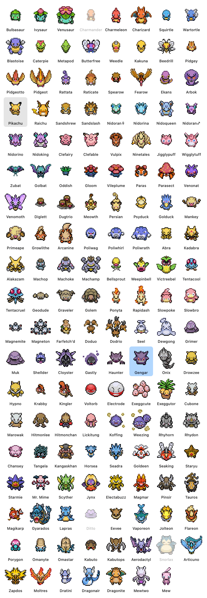

# Claude and Codex Agent Pokédex

Desktop Pokémon companions for Claude and Codex chats. Each session keeps its
own Pokémon, which paces while its agent works, flashes red when it needs you,
and celebrates when the reply is ready.

On Mac, this includes Claude Code, Claude desktop chats, the Codex CLI, Codex
in the ChatGPT app, Conductor, Orca, and herdr. Choose from **all 649 Pokémon
from Generations I through V**, with **1-in-25 shiny encounters**.


## Supported agents and apps

This table describes the source on `main`. The expanded Windows port is being
tested on a separate branch.

| Integration | Mac (`main`) | Windows (`main`) |
| --- | --- | --- |
| Claude Code in a local terminal | Yes, through installed hooks | Yes, through installed hooks |
| Claude desktop app chats | Yes, with Accessibility permission | Yes, through UI Automation |
| Codex CLI | Yes, automatically discovered | Windows preview branch |
| Codex in the ChatGPT app or Codex desktop app | Yes, for locally discoverable Codex threads | Windows preview branch |
| Conductor | Claude and Codex chats, workspace names and sidebar ordering | No native integration |
| Orca | Local Codex threads, including account-specific homes | Native Codex discovery on the Windows preview branch |
| herdr | Sidebar status, order, and pane navigation | Sidebar status, order, and pane navigation |
| Pokémon selection | 649 species, Generations I to V | Original 35-species selection |
| Shiny encounters | 1 in 25 per new appearance | Windows preview branch |

ChatGPT support means **Codex chats**, not ordinary ChatGPT conversations.
Orca support uses its local Codex state; there is no separate Orca sidebar reader.
Codex discovery depends on the local thread database and an active writer lock.
Closed historical chats and remote chats are not automatically included.

### Windows preview

The [`windows-parity` branch](https://github.com/alfonsokkim/claude-agent-pokedex/tree/windows-parity)
adds native Windows Codex discovery, all 649 species, generation pickers, normal
and shiny palettes, provider badges, improved alignment, staggered completion
captions, and turning animations for object-like Pokémon. It also adds a
GBA-style burst of gold stars when hovering over a shiny on Mac and Windows.

The branch has passed portable behaviour checks, native Windows checks, and Mac
regression checks in [GitHub Actions](https://github.com/alfonsokkim/claude-agent-pokedex/actions/runs/40381154169).
Live Windows desktop appearance, mixed-DPI displays, and app navigation still
need a hands-on smoke test. See the
[Windows verification notes](https://github.com/alfonsokkim/claude-agent-pokedex/blob/windows-parity/windows/README.md).
This preview has not been merged into `main` or published as a release.

## What the pets show

| Agent state | Pokémon behaviour |
| --- | --- |
| Working | Paces over a row of dots. Object-like Pokémon such as Bronzor and Klinklang turn through their facing directions on the spot instead. |
| Needs your attention | Hops and flashes red for a permission request, question, or other supported waiting state. Conductor also reports plan approval and errors. |
| Finished | Jumps over a “Pikachu is done” message for a new finished reply. Clicking acknowledges completion. |
| Idle | Steps in place, then falls asleep with drifting z's. |
| Unused for 12 hours | Shrinks into its Poké Ball. Activity brings it back with a ball-throw animation. |

On Mac, an orange Claude badge or blue Codex badge identifies the provider without
adding another prefix to the session name.

Hover to see the project and a FireRed-style **CTX bar showing context remaining**.
A full green bar means plenty of room; it drains through yellow to red as the
context fills. At 20% remaining or less, it stays visible without hovering.
Context is shown when the integration supplies enough information to calculate it.

## Pokémon and shinies

On Mac, right-click a pet and open **Pokemon → generation / region**:

| Generation | Region | National Pokédex | Species |
| --- | --- | --- | --- |
| I | Kanto | 001–151 | 151 |
| II | Johto | 152–251 | 100 |
| III | Hoenn | 252–386 | 135 |
| IV | Sinnoh | 387–493 | 107 |
| V | Unova | 494–649 | 156 |

Each newly assigned pet and each release from a Poké Ball rolls a **1-in-25
chance (4%)** of being shiny. Its appearance survives app restarts until it is
recalled. Waking from sleep or showing hidden pets does not reroll the colour.
Manually choosing a species starts it in its normal form, and the picker always
shows normal colours.

There are **1,298 normal and shiny appearances**, built from 649 walking sheets
and two palettes per species. Normal Virizion is green. Larger sprites keep
their proportions, and mixed-size pets share a centre line in vertical layouts.

The current **Generation I / Kanto** picker, showing all 151 Pokémon. The in-app
submenu scrolls; this full-grid render shows the complete list in one image.



## Install on Mac

Requires macOS 14 or later and Xcode's command-line tools:

```bash
xcode-select --install
```

**Install from git to get the features documented above:**

```bash
git clone https://github.com/alfonsokkim/claude-agent-pokedex.git
cd claude-agent-pokedex
./install.sh
```

The installer downloads the 649 sprite sheets and normal/shiny palettes, builds
`Claude Pet.app` into `~/Applications`, adds `claude-pet` and Claude Code's
`/pet` command, and adds status hooks to `~/.claude/settings.json` while retaining
your other settings. It then starts the app. Codex discovery needs no hooks.

To update a git installation, run `git pull` and then `./install.sh` again.
To start at login, add **Claude Pet** under System Settings → General → Login Items.

### Release downloads

The latest published release is **v1.7.0**. Its downloads contain the older
Claude-focused version with 35 Pokémon. They do **not** contain the current
Codex integration, 649-species collection, or shiny encounters.

| Platform | Published download |
| --- | --- |
| Mac, macOS 14 or later | [claude-agent-pokedex-mac.zip (v1.7.0)](https://github.com/alfonsokkim/claude-agent-pokedex/releases/download/v1.7.0/claude-agent-pokedex-mac.zip) |
| Windows 10 or 11, 64-bit | [claude-agent-pokedex-windows.zip (v1.7.0)](https://github.com/alfonsokkim/claude-agent-pokedex/releases/download/v1.7.0/claude-agent-pokedex-windows.zip) |

For the Mac zip, unzip it, open its folder in Terminal, and run `zsh install.sh`.

## Install on Windows

For the published version, unzip the Windows download and double-click
**install.cmd**. If SmartScreen blocks this unsigned app, use **More info → Run
anyway** if you want to proceed.

It installs to `%LOCALAPPDATA%\ClaudePet`, downloads sprites, adds the Claude Code
hooks to `%USERPROFILE%\.claude\settings.json` while retaining other settings,
installs `/pet`, and starts the pets. Nothing else needs installing for the
packaged app. This published version has not had a hands-on Windows smoke test.

For the expanded Windows preview, use the source on
[`windows-parity`](https://github.com/alfonsokkim/claude-agent-pokedex/tree/windows-parity).
With git and the .NET 8 SDK installed on Windows:

```powershell
git clone --branch windows-parity https://github.com/alfonsokkim/claude-agent-pokedex.git
cd claude-agent-pokedex
dotnet publish windows/ClaudePet.csproj -c Release -r win-x64 --self-contained -p:PublishSingleFile=true -p:IncludeNativeLibrariesForSelfExtract=true -o publish
& .\publish\ClaudePet.exe --install
```

Its CI workflow also packages a Windows zip as the `windows` artifact on
successful runs. For test coverage, see
[`windows/README.md`](https://github.com/alfonsokkim/claude-agent-pokedex/blob/windows-parity/windows/README.md).

To start at login, press Win+R, enter `shell:startup`, and add a shortcut to
`%LOCALAPPDATA%\ClaudePet\ClaudePet.exe`.

## Using it

- **Summon or dismiss:** use `/pet` in Claude Code, or `claude-pet` in a Mac terminal.
- **Click / Go to Agent:** acknowledge completion and bring the owning app or
  terminal forward. Claude desktop chats and herdr panes support direct navigation.
  On Mac, Conductor opens the workspace, and supported Codex desktop threads use
  a deep link. Selecting an exact terminal tab or Orca chat is not guaranteed.
- **Drag:** move one pet, including to another display. **Shift-drag** moves the
  group while preserving its layout.
- **Pokemon:** choose a species. Pets assigned to other sessions are faded;
  choosing one swaps the pair.
- **Return to Poke Ball / Let Out:** recall an idle pet or release a stored one.
  New session activity can bring a recalled pet back.
- **Line Up Pets:** arrange a column or row in any screen corner. On Mac,
  columns share a centre line and rows share a ground line. Alternating row
  captions sit below and above the sprites, with above-head messages clearing
  the CTX bar.
- **Size:** adjust all pets with a slider that settles around Small, Medium,
  and Large.
- **Mac menu-bar Poké Ball:** hide/show the group, return idle pets, or let out
  every stored pet. Hidden pets stay hidden until you show them.

## Claude desktop chats and Accessibility

A Claude desktop chat gets a pet when it starts replying and keeps it for a day
after its last reply. Clicking the pet opens the chat. Status comes from the
app's sidebar through Accessibility on Mac or UI Automation on Windows.

On Mac, enable **Claude Pet** under System Settings → Privacy & Security →
Accessibility. The app asks on first launch; **Show Claude App Chats…** in a
pet's menu can request it again. After rebuilding or reinstalling, macOS may
need you to remove the existing entry and add the current app again.

## Conductor on Mac

Visible chats in non-archived workspaces get pets for both Claude and Codex.
Ordering follows the root section first, then visible project order and workspace
activity. A project with one active workspace uses just the project name. With
multiple workspaces, labels use `[project] [workspace]: chat title`, preferring
the real workspace name over a generated city folder name.

Status and context come from Conductor's local database, supplemented by Claude
hooks and Codex question tracking. Codex threads already represented by Conductor
are deduplicated. Clicking brings Conductor to the owning workspace, with
Accessibility permission required for workspace navigation. It does not promise
to select a particular chat tab within that workspace.

## How it works

Claude Code hooks run `ClaudePet --hook` in the background and write a small
record per session. The app polls those files once a second in
`~/.local/share/claude-pet/sessions` on Mac or `%LOCALAPPDATA%\ClaudePet\sessions`
on Windows. It also checks local Claude transcripts for interrupted turns and
context usage, and watches the owning process for ended sessions.

On Mac, Codex discovery reads `~/.codex/state_5.sqlite`, active thread writer
locks, and local rollout events. Orca's runtime and account-specific Codex homes
are included. Questions, including supported asynchronous input prompts, keep
the pet flashing red until answered. Conductor supplies its own chat list and
herdr supplies its pane list. Claude desktop chat tracking reads sidebar status,
rather than conversation text.

To list discovered sessions:

```bash
# Mac
~/Applications/Claude\ Pet.app/Contents/MacOS/ClaudePet --status
```

```powershell
# Windows
& "$env:LOCALAPPDATA\ClaudePet\ClaudePet.exe" --status
```

## Troubleshooting

- **No Claude Code pets:** start the app, then send a message so a hook reports
  the session. Rerun the installer if hooks are missing.
- **No Codex pet on Mac:** the thread must be open locally and hold an active
  writer lock in a supported Codex home. Ordinary ChatGPT chats are not included.
- **No Claude desktop pets:** keep the Chats sidebar available and check Mac
  Accessibility permission. Re-add the current app if permission stopped working
  after a rebuild.
- **Clicking only opens the app:** exact terminal-tab and Orca-chat navigation
  are limited. Conductor workspace navigation needs Accessibility permission.
- **Still seeing the old 35-Pokémon picker on Mac:** install from the current git
  source rather than v1.7.0, then rerun the installer to fetch the full catalog.
- **Mac build fails:** install or update Xcode's command-line tools, then rerun
  the installer.
- **Missing sprites:** rerun the installer to retry downloads.

## Uninstall

- **Mac:** run `zsh install.sh --uninstall` from the source/download folder.
  Use `zsh install.sh --remove-hooks` to remove only the Claude Code hooks.
- **Windows:** double-click **uninstall.cmd** from the download.

Uninstalling removes the app, commands, hooks, downloaded sprites, and saved pet
settings. The source checkout is left in place.

## Project layout

| File | Purpose |
| --- | --- |
| `ClaudePet.swift` | Mac AppKit app, integrations, sprites, layout, and animations |
| `install.sh`, `build.sh`, `fetch-sprites.sh`, `hooks.js` | Mac installation, build, asset downloads, and hook setup |
| `claude-pet`, `pet.md` | Mac toggle command and Claude Code `/pet` command |
| `Info.plist` | Mac app bundle metadata |
| `Tests/` | Mac layout, shiny encounter, and attention-state checks |
| `windows/Program.cs` | Windows WPF app and installer |
| `windows/install.cmd`, `windows/uninstall.cmd` | Windows installation launchers |
| `.github/workflows/build.yml` | Builds and packages both apps; version tags publish releases |

## Sprites

The Gen 3-style walking sprites and normal/shiny overworld palettes come from
[pokeemerald-expansion](https://github.com/rh-hideout/pokeemerald-expansion).
The Poké Ball comes from [pret/pokefirered](https://github.com/pret/pokefirered),
and the Mac species catalog comes from [PokéAPI](https://pokeapi.co/).
Sprites are downloaded during installation rather than included in the repo.
Normal and shiny variants share walking frames and use separate palettes.

Pokémon is a trademark of Nintendo, Game Freak, and Creatures. Claude is a
trademark of Anthropic. This is a fan project, not affiliated with or endorsed
by those companies or OpenAI.
